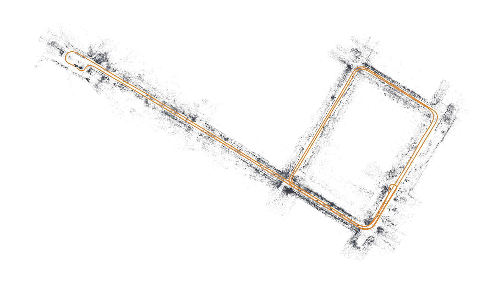
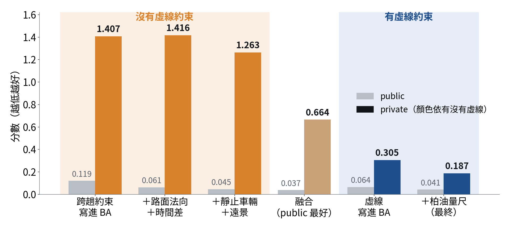
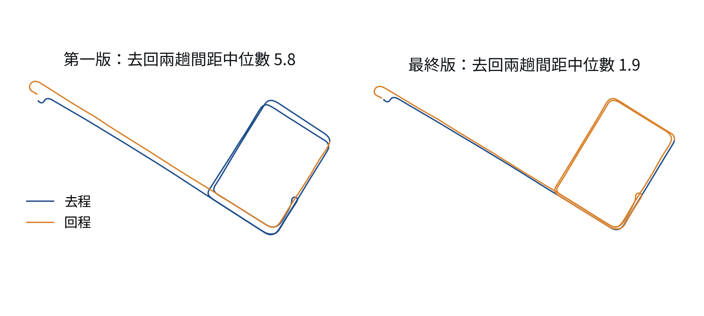
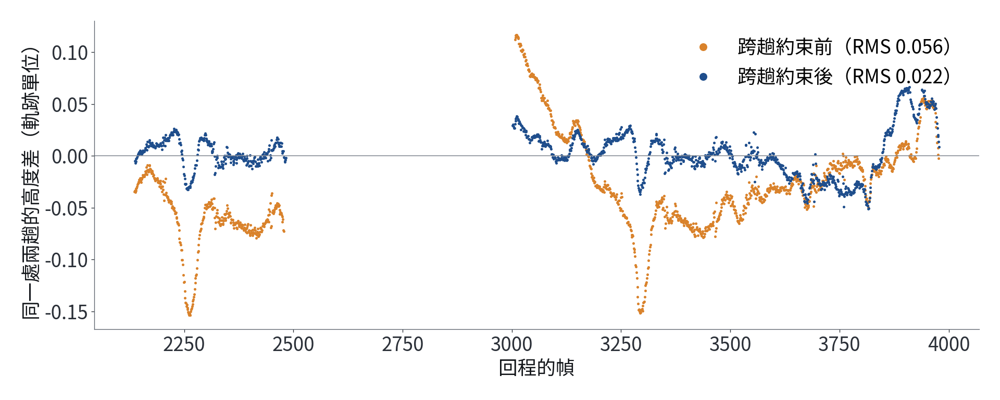
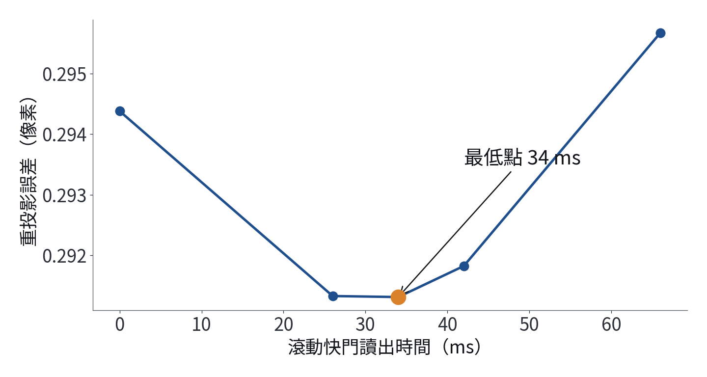

# SDC 2026 Midterm II — Visual SLAM（Team 12）

用車上前鏡頭的影像，估計每一幀的相機位姿（Track01 另有 IMU，Track02 沒有）。
Kaggle 競賽：`sdc-2026-midterm-ii-visual-slam-track-01`、`sdc-2026-midterm-ii-visual-slam-track-02`。
評分是軌跡先對真值做 Sim(3) 對齊，再算位置 RMSE，越低越好。public 只涵蓋一小段：Track01 是一個急彎附近的 132 幀，Track02 是一個 L 形路口。

- 簡報：https://claude.ai/artifact/Nv1tBRU3k72aaiz7NkhJmu
- 全程影片：https://youtu.be/wfRxi4plZ_w（白點是 BA 建出的地圖，彩色點是當下這一幀看到的點）

## 結果

| | 選中的提交 | public | private | 名次 |
|---|---|---|---|---|
| Track02（無 IMU） | `t2_sfmx_homo_ult_frp_v2_dt41` | 0.041 | **0.187** | **第 1 名**（第 2 名 0.547） |
| Track01（有 IMU） | `t1_fuse5050_c10gcam3_fullvio_v4pure` | 0.066 | 0.107 | 第 9 名 |

- Track02 交過的提交中 private 最好的是同一套方法的 `t2_sfmx_homo_ult_frp_dt41`（0.184）。
- Track01 交過的提交中 private 最好的是 `t1_rs26_dt35`（0.065，可排第 2）。它的 public 0.069 比較差，所以當時沒選。
- 賽後晚交，時間差改用純物理推算的 −35 ms：Track02 private 0.183、Track01 private 0.066。



## 核心想法

同一條路會經過不只一次：Track02 大部分路段是去程、回程各一趟，方向相反；Track01 是同方向三圈。
我們用重複經過的地方互相校正，並逐一找出剩下誤差的物理來源，把每個來源寫成管線裡的一步：鏡頭畸變、去回兩趟的相對位置、長直路的沿路漂移、相機和 GT 的時間差、滾動快門。

## Track02 的方法（依 private 實際改善排序）

private 欄是 Kaggle 上加入該方法前、後兩個提交的 private 分數。

| 排名 | 方法 | 修掉的誤差 | 怎麼發現的 | private |
|---|---|---|---|---|
| 基礎 | 前端位姿圖：SIFT 配對＋LoGeR 點雲深度做 PnP，再用 GTSAM 最佳化 | 逐幀的相對運動 | — | 4.05 |
| 1 | 跨趟迴環：同方向用位置搜尋＋影像檢索；反方向用點雲 GICP 和俯視路面標線轉 180° 對齊；SegFormer 遮掉車和人 | 同一地點不同趟之間的漂移 | 把軌跡畫出來：起點和終點是同一處，卻差了 15 m；同一條路的去回兩趟相距 6 m | 4.05 → 2.04 |
| 2 | 近距黃色虛線端點寫進 BA | 長直路的沿路漂移 | 近距虛線端點在 private 的長直路上量到 −0.99 m 的單調漂移，public 看不到 | 1.42 → 0.305 |
| 3 | 影像 BA，自校正鏡頭 | 點雲深度偏差、鏡頭畸變 | 迴環後各趟已彼此對齊，分數卻停住；題目給的相機沒有畸變，但鏡頭其實有 | 1.85 → 1.59 |
| 4 | 跨趟等高、黃色中線、路面法向寫進 BA | 去回兩趟的相對高度和橫向 | BA 後去回兩趟被橫向推開 0.2–0.5 單位，同一段路高度對不上 | 1.59 → 1.41 |
| 5 | 柏油路面量尺：用前方整片柏油的稠密單應性量每一步的步長 | 沒有虛線處的局部尺度 | 稀疏 SIFT 路面點只覆蓋約 20% 的路面，量到的步長和虛線步長幾乎無關 | 0.305 → 0.187 |
| — | 時間平移 | 相機和 GT 時刻差造成、和車速成正比的沿路偏移 | 分數讀值拆出的沿路誤差和車速相關（r = +0.86） | public 改善，private 沒看到明顯改善 |
| — | 滾動快門（讀出 34 ms） | 轉彎時影像上下列的時刻差 | 時間差修完後，剩下的誤差只在轉彎出現 | public 改善，private 多是直路，影響很小 |
| — | 兩個解 50/50 融合 | 兩個解各自的誤差 | — | public 最好（0.037），private 變差（0.664） |

沒有虛線約束的版本，public 再好，private 都在 1.3–1.4 左右。public 只涵蓋 L 形路口，看不到 private 長直路的沿路漂移。



| 第一版 vs 最終版（去回兩趟） | 跨趟約束前後的高度差 | 滾動快門讀出時間（在非 public 的急彎上量） |
|---|---|---|
|  |  |  |

### 每一層用到的資訊

| 層 | 用到的資訊 |
|---|---|
| 前端（`slam_v2.py`） | SIFT 配對、LoGeR 點雲深度、車輛約束（不側滑，順便校正相機安裝角）、影像檢索、點雲 GICP、俯視圖路面標線、黃色虛線週期 |
| BA（`sfm_ba.py`） | 多張照片共同看到的 SIFT 點（自己三角化，不用 LoGeR 深度）、自校正鏡頭、前端軌跡當弱先驗；遮掉會動的車和人，留下通過剛體檢驗的路邊停車，丟掉畫面第 850 列以下的引擎蓋 |
| 跨趟約束（`pass_consensus.py`、`dash_along.py`） | 兩趟相機離地高度相同、黃色中線位置相同、路面法向、近距虛線端點去回配對 |
| 柏油量尺（`road_homography.py`） | 相隔兩幀的柏油紋理、未來軌跡點擬合的前方路面平面 |
| 時間平移（`time_resample.py`） | 一個全域時間差 |

沒有用到 GPS、外部地圖、衛星影像或真值。

### 時間差怎麼來的

- 相機比 IMU 晚 19.0 ms：在 Track01 上把純影像 BA 的角速度和 IMU 陀螺儀做互相關量到（相關 0.9998）。兩個 track 是同一台車、同一台相機。
- LiDAR 半圈 53.98 ms：Track02 的影像間隔是穩定的 107.96 ms，假設 LiDAR 每幀轉一圈、GT 時刻記在掃描端點，等效時刻就差半圈。這一項是假設，題目沒有給。
- 54 − 19 ≈ 35 ms，和分數讀值的「沿路誤差 ÷ 車速」（分 6 段都落在 31–35 ms）一致。
- 選中的提交用 −41 ms，這是參考 public 選的；純物理的 −35 ms 晚交 private 是 0.183。

## Track01 的方法

前端：陀螺儀相對旋轉約束、車輛約束（後輪不側滑）、用三角化路面的相機高度修正點雲尺度、只用影像幾何的 VO 平移方向；參數都用「逐圈留出」驗證選，不看 public。
選中的是前端位姿圖和 VIO 解的 50/50 融合。private 最好的則是純影像 BA，加自校正鏡頭、移動物體遮罩、滾動快門和時間平移，和 Track02 同一套。

## 程式

| 檔案 | 用途 |
|---|---|
| `image_slam_starter/slam_v2.py` | 前端：SIFT＋LoGeR 點雲 PnP、每幀點雲尺度、GTSAM 位姿圖、迴環（同方向、反方向 GICP、影像檢索、俯視標線）、虛線量尺、陀螺儀與車輛約束 |
| `image_slam_starter/process/sfm_ba.py` | 影像 BA（pycolmap / pyceres）：自校正 RADIAL 鏡頭、滾動快門 `--rs-readout-ms` / `--rs-6dof`、移動物體遮罩 `--mask-obj`、路邊停車 `--keep-static-obj`、引擎蓋 `--mask-v-max`、跨趟約束 `--cross-pass`、柏油步長 `--step-prior` |
| `image_slam_starter/process/pass_consensus.py` | 跨趟等高、黃色中線、路面法向，輸出跨趟約束配對 |
| `image_slam_starter/process/centerline_sep.py` | 從俯視圖找黃色中線 |
| `image_slam_starter/process/dash_along.py` | 近距黃色虛線端點的去回配對 |
| `image_slam_starter/process/road_homography.py` | 柏油路面稠密單應性步長 |
| `image_slam_starter/process/time_resample.py` | 軌跡沿時間平移、重新取樣 |
| `image_slam_starter/process/fuse.py` | 兩條軌跡 Sim(3) 對齊後融合 |
| `image_slam_starter/process/segment_road.py` | SegFormer 分割，產生 `seg.npz` |
| `image_slam_starter/process/diag/` | 分數讀值、MVUE / CRLB 誤差診斷 |
| `viewer/` | Track01 軌跡檢視頁 |
| `submissions/` | 關鍵版本的提交檔，見 `submissions/README.md` |

## 環境與資料

- 前端：Python 3.9，`pip install -r requirements.txt`（gtsam 4.2 需要 numpy < 2）。
- BA 與分割：Python 3.11、PyTorch 2.8（CUDA 12.8）、pycolmap 4.2.1、pyceres 2.6、transformers 4.49（SegFormer-B2 Cityscapes 公開權重）。
- 資料不隨 repo 提供：從 Kaggle 下載，放成 `data/Track1/data/{images,raw_ply,camera_info.json,imu.csv}`、`data/Track2/data/{images,raw_ply,camera_info.json}`，再建捷徑：

```bash
ln -s ../data/Track1 image_slam_starter/Track1
ln -s ../data/Track2 image_slam_starter/Track2
cd image_slam_starter
python process/segment_road.py Track2      # 產生 Track2/seg.npz（--mask-obj、--loop-seg 需要）
```

以下指令都在 `image_slam_starter/` 底下執行，輸出寫在 `TrackN/result/`。

## 重現

### Track02（選中的 `t2_sfmx_homo_ult_frp_v2_dt41`）

```bash
# 0a 前端 SLAM → 影像 BA
python slam_v2.py Track2 --cam 1035.5,1033.88,722.17,456.84,-0.05833,0.088413,0,0 \
  --loop-radii 30,12,5 --loop-retrieval 10 --rev-loops 3 --rev-sigma 1.5,0.4,0.4,1000 --loop-seg \
  --bev-loops 1 --bev-sigma 0.2,0.1,0.4 --bev-ahead 10,14,18 --bev-roll --height-scale 0 \
  --dash-ruler 0.01 --no-dash-robust --dash-cruise 0.1 --zmax 16 --bev-unit-scale 1.035 --out t2_cz16_bu1035.csv
python process/sfm_ba.py Track2 Track2/result/t2_cz16_bu1035.csv \
  --out t2_sfm_bu1035_sf --model RADIAL --square --camera 1035.5,722.16,456.82,-0.05832,0.08844 \
  --pose-prior 0.6 --rounds 8,4,2 --repeat-last 4 --max-iter 500 --solver sparse --split-conflicts --verify-undistort

# 0b 黃色中線 → 跨趟約束配對 → 跨趟約束寫進 BA → 路面法向
python process/centerline_sep.py Track2 Track2/result/t2_sfm_bu1035_sf.csv --frames 0:4206
python process/pass_consensus.py Track2 Track2/result/t2_sfm_bu1035_sf.csv --out _tmp_pcm \
  --centerline Track2/result/centerline2_0-4206_-0.21_-1.49.npz \
  --h 1.13 --h-auto --h-prior 1.132,0.02 --sigma-auto --cross-slope 0.02 --line-sys 0.02 \
  --gate-ref Track2/result/t2_cz16_bu1035.csv --dump-pairs Track2/result/xpairs_bu1035_sf.npz
python process/sfm_ba.py Track2 Track2/result/t2_sfm_bu1035_sf.csv --out t2_sfmx_q \
  --model RADIAL --square --camera 1035.939506,721.928323,456.668841,-0.059671,0.091874 --pose-prior 0.6 \
  --rounds 2 --repeat-last 1 --max-iter 150 --solver sparse --split-conflicts --verify-undistort \
  --cross-pass Track2/result/xpairs_bu1035_sf.npz
python process/sfm_ba.py Track2 Track2/result/t2_sfmx_q.csv --out t2_sfmx_c \
  --model RADIAL --square --camera 1035.9,721.99,456.56,-0.059665,0.091941 --pose-prior 0.6 \
  --rounds 2 --max-iter 3000 --solver sparse --split-conflicts --verify-undistort \
  --cross-pass Track2/result/xpairs_bu1035_sf.npz
python process/pass_consensus.py Track2 Track2/result/t2_sfmx_c.csv \
  --out t2_sfmx_c_rn1d --road-normal --vertical-only --sigma-auto --cross-slope 0.01 --curv-up 5e-5

# 0c 近距虛線 → 含虛線（ult）和不含虛線（nodash）兩組跨趟配對
python process/dash_along.py Track2 Track2/result/t2_sfmx_c_rn1d.csv \
  --centerline Track2/result/centerline2_0-4206_-0.21_-1.49.npz \
  --rs-readout-ms 26.0 --max-pitch-nod 0.35 --sigma 0.05 --out Track2/result/dash_along_rs26.npz
python process/pass_consensus.py Track2 Track2/result/t2_sfmx_c_rn1d.csv --out _tmp_dump_ult \
  --centerline Track2/result/centerline2_0-4206_-0.21_-1.49.npz \
  --h 1.13 --h-auto --h-prior 1.132,0.02 --sigma-auto --cross-slope 0.01 --line-sys 0.02 \
  --gate-ref Track2/result/t2_cz16_bu1035.csv --road-normal --line-normal --max-dbl-dist 0.30 \
  --opp-dbl-dil 2 --fix-huber --dash-along Track2/result/dash_along_rs26.npz \
  --dump-pairs Track2/result/xpairs_ult_m4.npz --dump-sigma-scale 0.25
python process/pass_consensus.py Track2 Track2/result/t2_sfmx_c_rn1d.csv --out _tmp_dump_nd \
  --centerline Track2/result/centerline2_0-4206_-0.21_-1.49.npz \
  --h 1.13 --h-auto --h-prior 1.132,0.02 --sigma-auto --cross-slope 0.01 --line-sys 0.02 \
  --gate-ref Track2/result/t2_cz16_bu1035.csv --road-normal --line-normal --max-dbl-dist 0.30 \
  --opp-dbl-dil 2 --fix-huber --dash-along Track2/result/dash_along_rs26.npz \
  --dump-pairs Track2/result/xpairs_nodash_m2.npz --dump-sigma-scale 0.5 --dump-drop-kind 2

# 1 不含虛線的參考軌跡（給柏油量尺用）
python process/sfm_ba.py Track2 Track2/result/t2_sfmx_c_rn1d.csv \
  --out t2_sfmx_nodash_rs34_6dof_hm --model RADIAL --square --camera 1035.94,722.04,456.56,-0.059663,0.091900 \
  --pose-prior 1.0 --rs-readout-ms 34.0 --rs-6dof --mask-v-max 850 --rounds 2 --max-iter 200 \
  --solver sparse --split-conflicts --verify-undistort --cross-pass Track2/result/xpairs_nodash_m2.npz --cross-loss 4.0

# 2 柏油路面量尺
python process/road_homography.py Track2 Track2/result/t2_sfmx_nodash_rs34_6dof_hm.csv \
  --out road_step_t2_frp_v2 --rs-readout-ms 34.0 --future-road-plane --max-wy 6.0 --min-sobs 0.22

# 3 最終 BA：虛線約束＋柏油步長＋路邊停車＋遠景＋滾動快門＋引擎蓋遮罩
python process/sfm_ba.py Track2 Track2/result/t2_sfmx_c_rn1d.csv \
  --out t2_sfmx_homo_ult_frp_v2 --model RADIAL --square --camera 1035.94,722.04,456.56,-0.059663,0.091900 \
  --pose-prior 5.0 --mask-obj 128 --keep-static-obj --min-parallax 0.7 --rs-readout-ms 34.0 --rs-6dof \
  --mask-v-max 850 --step-prior Track2/result/road_step_t2_frp_v2.npz --step-sigma 0.025 --step-loss 2.0 \
  --rounds 2 --max-iter 200 --solver sparse --split-conflicts --verify-undistort \
  --cross-pass Track2/result/xpairs_ult_m4.npz --cross-loss 4.0

# 4 時間平移（選中的是 -41；純物理推算是 -35）
python process/time_resample.py Track2/result/t2_sfmx_homo_ult_frp_v2.csv \
  ../submissions/track2/t2_sfmx_homo_ult_frp_v2_dt41.csv --sign 0 --shift -41
```

`--camera` 的數字是上一次 BA 自校正出的鏡頭參數（f、cx、cy、k1、k2），寫在對應輸出的 `.json` 裡。

### Track01（晚交的 `t1_sfm_rs34_dt35_late`，private 0.066）

```bash
python slam_v2.py Track1 --vo --height-lap-gain 0 --height-scale 5 --out v10_vo_shared_it5.csv
python process/segment_road.py Track1
python process/sfm_ba.py Track1 Track1/result/v10_vo_shared_it5.csv --out t1_sfm_rs34_phys \
  --model RADIAL --square --mask-obj 128 --pose-prior 1.0 --rs-readout-ms 34
python process/time_resample.py Track1/result/t1_sfm_rs34_phys.csv \
  ../submissions/track1/t1_sfm_rs34_dt35_late.csv --sign 0 --shift -35
```

賽中 private 最好的 `t1_rs26_dt35`（0.065）用的是同一組 BA 設定，只是讀出時間設 26 ms；它當初的起點軌跡沒有留下紀錄，所以這裡改列參數完整的晚交版本。

## 開發方式與合規

- 開發時使用 AI 程式助理：Claude Code（前端、跨趟約束、影像 BA）與 Gemini（MVUE / CRLB 誤差診斷、時間差、滾動快門、近距虛線實作、柏油量尺實作），兩者互相審查程式；方向與提交由我決定。
- `submissions/` 裡的檔案都是管線的輸出，沒有手改位姿，可以用上面的指令重現。
- 部分參數（時間差 −41 ms、BEV 單位 ×1.035）是參考 public 分數選的，已在上文標出。
